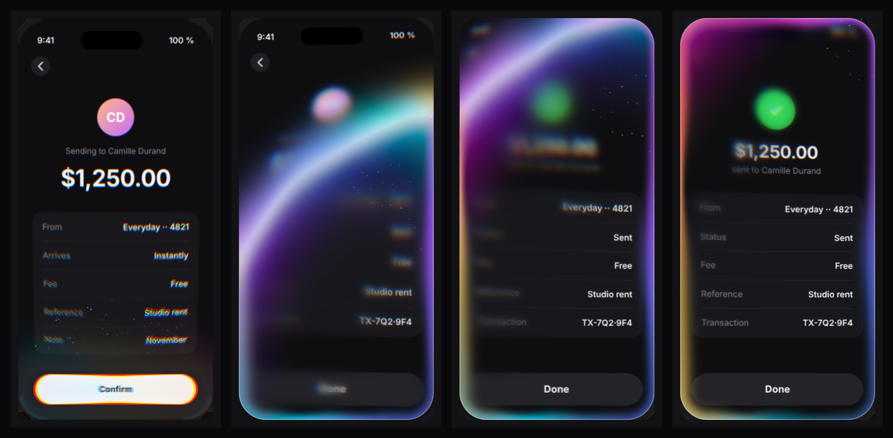

# distortion-wave

A distortion-wave transition for **any DOM element**. A button, a card, a tab panel, the whole page.

You give it an element and a function that changes the DOM. It captures the element before and after, then one WebGL2 pass carries the old state into the new one: the screen gets pulled toward the source, a lensed, blurred, colourful wave leaves from where you touched, and its colour lingers on the edges.



Inspired by Jakub Antalik's [Distortion Waves](https://libraries.dev/waves) for SwiftUI. This is an independent web implementation, not affiliated with libraries.dev.

- Zero dependencies, ~17 kB gzipped
- Same model as `document.startViewTransition()`
- Your update **always** runs: no WebGL, element off screen, reduced motion, capture error… you just get the change without the wave
- Keyboard focus is kept when your update replaces the focused control

## Install

```sh
npm i distortion-wave
```

From a CDN, no build step (CodePen, a plain HTML page…):

```html
<script type="module">
  import { distortionWave } from 'https://cdn.jsdelivr.net/npm/distortion-wave@0.3/+esm';
</script>
```

Or the IIFE build, which exposes `window.DistortionWave`:

```html
<script src="https://cdn.jsdelivr.net/npm/distortion-wave@0.3/dist/distortion-wave.iife.min.js"></script>
```

### Everything, or only the looks you use

The wave (the core) is always there. Each other look (see [Effects](#effects)) is its own entry, so you only pay for the ones you use.

| Entry | Gzipped | What's in it |
|---|---|---|
| `distortion-wave` | 16.9 kB | the wave, the API, every option |
| `distortion-wave/electric` | 5.8 kB | `electric`, `electricBorder` |
| `distortion-wave/pixel` | 1.1 kB | `pixel` |
| `distortion-wave/glass` | 1.0 kB | `glass` |
| `distortion-wave/burn` | 1.3 kB | `burn` |
| `distortion-wave/ink` | 1.2 kB | `ink` |
| `distortion-wave/halftone` | 1.0 kB | `halftone` |
| `distortion-wave/metal` | 1.1 kB | `metal` |
| `distortion-wave/water` | 1.2 kB | `water` |
| `distortion-wave/all` | 24.6 kB | the core and every look |

**Only some looks, with a bundler.** Import the core, then each look from its own entry. Only what you import ships: here 16.9 + 1.3 + 1.2 kB.

```js
import { distortionWave } from 'distortion-wave';
import { burn } from 'distortion-wave/burn';
import { water } from 'distortion-wave/water';

distortionWave(card, update, { effect: burn });
```

**Everything, with a bundler.** One import, every look:

```js
import { distortionWave, burn, glass, water } from 'distortion-wave/all';
```

**Only some looks, without a bundler.** Load the core's IIFE, then the IIFE of each look. Each look sets its own global (`DistortionWaveBurn`, `DistortionWaveGlass`…):

```html
<script src="https://cdn.jsdelivr.net/npm/distortion-wave@0.3/dist/distortion-wave.iife.min.js"></script>
<script src="https://cdn.jsdelivr.net/npm/distortion-wave@0.3/dist/burn.iife.min.js"></script>
<script>
  DistortionWave.distortionWave(card, update, { effect: DistortionWaveBurn.burn });
</script>
```

**Everything, without a bundler.** `all.iife.min.js` puts the core and every look on `window.DistortionWave`:

```html
<script src="https://cdn.jsdelivr.net/npm/distortion-wave@0.3/dist/all.iife.min.js"></script>
<script>
  const { distortionWave, burn } = DistortionWave;
  distortionWave(card, update, { effect: burn });
</script>
```

**One file to host yourself.** On the site, the Install section has a download builder: tick the looks you want, and it gives you a single file with the core and those looks, all on `window.DistortionWave`, with its size. Ticking every look gives the `all` build.

## Usage

```js
import { distortionWave, warmupWave } from 'distortion-wave';

warmupWave(); // optional: compiles the shaders before the first click

confirmButton.addEventListener('click', (event) => {
  distortionWave(screen, () => {
    screen.dataset.state = 'sent';       // any DOM change: classes, innerHTML, a re-render…
  }, {
    source: confirmButton,               // where the wave starts
    focus: event,                        // the touch point: the wave leaves from there and leans that way
  });
});
```

The source can be inside or outside the target. When it is outside, the wave enters from that edge and travels toward the bulk of the target.

### A single button

```js
button.addEventListener('click', (event) => {
  distortionWave(button, () => {
    button.textContent = 'Subscribed';
  }, { focus: event });                  // no source: a ring from the touch point
});
```

### The whole page (theme switch)

```js
themeSwitch.addEventListener('click', (event) => {
  distortionWave(document.querySelector('#app'), () => {
    app.dataset.theme = app.dataset.theme === 'dark' ? 'light' : 'dark';
  }, { source: themeSwitch, focus: event });
});
```

Only the part visible in the viewport is captured and animated, so a long page costs the same as a screen.

### React

The DOM has to be updated when your callback returns, so the state change goes through `flushSync` (same as with View Transitions). A small hook keeps that in one place:

```jsx
import { useCallback } from 'react';
import { flushSync } from 'react-dom';
import { distortionWave } from 'distortion-wave';

export function useWave(defaults) {
  return useCallback((target, update, options) => {
    const el = target && 'current' in target ? target.current : target;
    if (!el) { update(); return null; }
    return distortionWave(el, () => flushSync(update), { ...defaults, ...options });
  }, [defaults]);
}
```

```jsx
function Pricing() {
  const wave = useWave();
  const panel = useRef(null);
  const [plan, setPlan] = useState('monthly');
  return (
    <>
      <button onClick={(e) => wave(panel, () => setPlan('yearly'), { source: e.currentTarget, focus: e })}>Yearly</button>
      <div ref={panel}>{plan === 'yearly' ? <Yearly /> : <Monthly />}</div>
    </>
  );
}
```

Pass `defaults` from a `useMemo` (or a constant) so the callback stays stable. The full example is in [`examples/react/`](examples/react/).

### Shortcut

```js
import { waveOnClick } from 'distortion-wave';
waveOnClick(trigger, target, (event) => { /* update */ }, { palette: 'ocean' });
```

`waveOnClick` also pre-captures the target when the pointer enters the trigger or it gets focus, so the "before" capture costs nothing at click time.

## Effects

Effects change the look of the wave, not its behaviour. The wave is built in; other looks ship as their own entry, so the core stays at ~17 kB gzipped when you don't use them.

### Electric

`distortion-wave/electric` (~6 kB gzipped) brings the electric look, for the wave and as a border.

```js
import { distortionWave } from 'distortion-wave';
import { electric, electricBorder } from 'distortion-wave/electric';

// The same wave (timing, lens, blur, sparks) with an electric look: the front is a crackling bolt,
// the colour band goes electric, the outline charges with arcs as the front passes
distortionWave(card, update, { effect: electric, source: button, focus: event });

// A live arc on the outline, rounded corners included
const border = electricBorder(card, { trigger: 'hover', color: '#7df9ff' });
border.destroy();   // fades out, removes the listeners
```

Without a bundler: `https://cdn.jsdelivr.net/npm/distortion-wave@0.3/dist/electric.js` (ES module, no imports of its own), or `dist/electric.iife.min.js` for `window.DistortionWaveElectric`.

**With `effect: electric`** every wave option works the same (`source`, `focus`, `variant`, `duration`, `easing`, `palette`, `particles`, the fine-tuning keys…). The default palette becomes `'electric'`. Its own keys, at the same reference scale:

| Key | Default | |
|---|---|---|
| `jag` | `8` px | how jagged the front is |
| `scale` | `46` px | one noise cell along the front; smaller is more jagged |
| `crackle` | `1.8` | speed of the crackle |
| `chaos` | `6` px | how far the bolts stray from the front |
| `boltWidth`, `boltGlow` | `1.5`, `14` px | bright core of a bolt, glow around it |
| `bolts`, `rimBolts` | `1.2`, `1.3` | strength of the bolts on the front, of the arcs on the outline (0 = none) |

`intensity` also scales `jag` and `chaos`.

**Border options**: `color` or `palette` (default `'electric'`), `trigger` (`'always'`, `'hover'`, `'focus'`, `'hover focus'`, `'manual'`), `thickness`, `glow`, `chaos`, `scale`, `crackle`, `offset`, `intensity`, `fadeIn`, `fadeOut`, `zIndex`. The controller has `start()`, `stop()`, `set(options)`, `destroy()` and `active`. Every border of the page draws in one shared canvas: a grid of cards costs one WebGL context. With `prefers-reduced-motion`, the arc stays still.

### Pixel

`distortion-wave/pixel` (~1.2 kB gzipped): the same wave with a pixel look. Near the front, the content turns into small pixels that flip from the old state to the new one cell by cell; some light up in the palette and flicker; the outline is drawn in pixels that go out one by one; sparks are square. Default palette `'pixel'` (orange).

```js
import { pixel } from 'distortion-wave/pixel';
distortionWave(card, update, { effect: pixel, source: button, focus: event });
```

| Key | Default | |
|---|---|---|
| `cell`, `gap` | `6`, `1` px | size of a pixel, gap between pixels (0 = a plain mosaic) |
| `zone` | `1` | width of the pixel zone around the front, × the band's `lead` |
| `density` | `0.45` | share of lit pixels at the front |
| `rate` | `14` | flicker, changes per second |
| `lit`, `rimPixels` | `1`, `1` | strength of the lit pixels, of the pixels on the outline (0 = none) |

CDN: `https://cdn.jsdelivr.net/npm/distortion-wave@0.3/dist/pixel.js`, or `dist/pixel.iife.min.js` for `window.DistortionWavePixel`.

### More looks

Six more entries, each about 1 to 1.3 kB gzipped, same pattern: `import { glass } from 'distortion-wave/glass'`, then `effect: glass`. Every wave option still applies; each look adds its own keys (sizes at the 360 × 740 reference scale) and exports their defaults (`GLASS`, `BURN`, `INK`, `HALFTONE`, `METAL`, `WATER`). A key shared by two looks means the same thing in both.

**`distortion-wave/glass`** (~1.0 kB gzipped, `window.DistortionWaveGlass` from `dist/glass.iife.min.js`). Behind the front a thick slab of glass bends the content like a lens, splits it into RGB at its slopes and catches the light on its faces. Pale glass palette.

| Key | Default | |
|---|---|---|
| `thickness` | `90` px | width of the slab behind the front |
| `refraction`, `dispersion` | `26`, `5` px | how far the slab bends what's under it, RGB split at its slopes |
| `shine`, `tint` | `1`, `0.25` | highlights, palette tint of the glass (0 = none, clear) |

**`distortion-wave/burn`** (~1.3 kB gzipped, `window.DistortionWaveBurn` from `dist/burn.iife.min.js`). The front burns the old content away along a ragged edge pinned to the content: scorch ahead, a white-hot rim, smoke and embers drifting up behind. Made for a delete. Palette `'ember'`.

| Key | Default | |
|---|---|---|
| `roughness`, `scale` | `32`, `100` px | how ragged the edge is, one noise cell |
| `char`, `heat` | `70`, `11` px | scorched zone ahead, width of the glowing edge |
| `embers`, `smoke` | `1`, `0.5` | embers and smoke behind the edge (0 = none) |

**`distortion-wave/ink`** (~1.3 kB gzipped, `window.DistortionWaveInk` from `dist/ink.iife.min.js`). Risograph. The front bleeds like ink soaking into paper; around it the content is reprinted in two inks (the palette's first two colours), out of register, dithered by the paper's grain. Riso palette (fluorescent pink, blue, yellow, green).

| Key | Default | |
|---|---|---|
| `bleed`, `scale` | `30`, `110` px | how far the ink spreads, one noise cell |
| `misregister`, `ink` | `3`, `36` px | offset between the two inks, width of the wet ink behind the front |
| `grain`, `zone` | `1`, `1.2` | paper grain (0 to 1), printed zone × the band's `lead` |

**`distortion-wave/halftone`** (~1.0 kB gzipped, `window.DistortionWaveHalftone` from `dist/halftone.iife.min.js`). Near the front the content turns into a rotated dot screen: dark dots on light content, light dots on dark, sized by its tone, swelling with the wave and inked in the palette at its peak. CMYK-like palette.

| Key | Default | |
|---|---|---|
| `cell`, `angle` | `7` px, `45`° | one cell of the screen, its angle |
| `zone`, `size` | `1.1`, `1.2` | screen zone × the band's `lead`, largest dot × the cell |
| `ink` | `0.7` | palette ink at the front (0 = the content's own colours) |

**`distortion-wave/metal`** (~1.1 kB gzipped, `window.DistortionWaveMetal` from `dist/metal.iife.min.js`). Liquid metal. The front is a rolling bead of chrome that wobbles, mirrors a procedural studio and, faintly, the content. Best on a dark page. Chrome palette that tints the reflections.

| Key | Default | |
|---|---|---|
| `thickness`, `wobble` | `46`, `14` px | width of the bead, slow wobble of the front |
| `ripple`, `shine` | `0.6`, `1` | ripples on the surface, specular highlight |
| `reflect` | `0.35` | how much of the content the metal mirrors (0 to 1) |

**`distortion-wave/water`** (~1.2 kB gzipped, `window.DistortionWaveWater` from `dist/water.iife.min.js`). Ripples trail the front and refract the content, the water tints it, caustics dance on it and foam breaks on the front. Palette `'ocean'`.

| Key | Default | |
|---|---|---|
| `wavelength`, `refraction` | `44`, `9` px | distance between ripples, how far they bend the content |
| `caustics`, `foam` | `1`, `1` | light patterns, foam on the front (0 = none) |
| `tint` | `0.35` | palette tint of the water (0 = clear) |

## Examples

- [`demo/`](demo/): a payment screen, a single button, a tab panel, a media card, an element that changes size and a whole-page theme switch.
- [`examples/ui-kit/`](examples/ui-kit/): about 40 clickable UI pieces in five groups (buttons, toggles and selection, commerce, navigation and content, forms and feedback), plus a theme switch that waves the whole page and an Options panel (duration, easing, intensity, palette). `index.html`, `style.css` and `script.js` paste straight into CodePen; `standalone.html` opens from disk.
- [`examples/react/`](examples/react/): React 19 + Vite, with the `useWave` hook, a like button, tabs, a list that grows, a theme switch and live options. `npm install && npm run dev` in that folder. `codepen.jsx` is the same app for CodePen (JS preprocessor: Babel).

## AI agents

[`skill/`](skill/) holds an Agent Skill for coding agents (Claude Code, Cursor, Codex…): how to pick the target and the source, framework patterns, options, troubleshooting, and a script that films a wave frame by frame. Install notes in [`skill/README.md`](skill/README.md).

## API

### `distortionWave(target, update?, options?) → WaveTransition`

| Option | Default | |
|---|---|---|
| `source` | touch point, else center | where the wave starts: an `Element` (inside or outside the target), a `DOMRect` or `{ x, y }` |
| `focus` | `null` | the `PointerEvent`/`MouseEvent` (or `{ x, y }`): the wave leans toward it. Keyboard clicks are ignored |
| `variant` | `'auto'` | `'vertical'`, `'horizontal'`, `'center'`. Auto: wide source → vertical, tall → horizontal, square or point → center |
| `palette` | `'aurora'` | `'aurora'`, `'ocean'`, `'mint'`, `'ember'`, or up to 8 colours (interpolated in OKLab) |
| `duration` | auto | total length in ms, until `finished`. By default it depends on the size: about 2 s for a button, 4 s for a whole page, the last half being the glow fading out |
| `easing` | `'cubic-bezier(0.2, 1, 0.3, 1)'` | how the front travels: a CSS keyword (`'linear'`, `'ease-out'`…), `'cubic-bezier(…)'`, `[x1, y1, x2, y2]` or a function |
| `speed` | `1` | time multiplier on the automatic duration (`0.3` = slow motion). Ignored when `duration` is set |
| `intensity` | `1` | strength of the distortion (displacement, bulge, chromatic aberration). `0` keeps only the colours |
| `particles` | `true` | `false`, or a count |
| `reducedMotion` | follows `prefers-reduced-motion` | `true` gives a 220 ms crossfade |
| `preserveFocus` | `true` | move focus to the equivalent control if the update replaced the focused one |
| `timeout` | `3000` | max ms to wait for the "after" capture |
| `onLaunch`, `onCovered`, `onSettled`, `onEnd(metrics)` | | callbacks |

```js
distortionWave(card, update, { duration: 1400, easing: 'ease-in-out', intensity: 0.5, palette: ['#ff5a7a', '#ffffff'] });
```

**Defaults for the whole app.** `setWaveDefaults({ duration: 900, palette: 'ocean' })` applies to every wave; options passed to a call still win. `setWaveDefaults(null)` resets.

<details>
<summary><b>Fine tuning</b>: every key of the presets</summary>

Values are given for a 360×740 screen and scaled to the target, so a button gets a thinner rim and a shorter wave. Lengths in px, times in seconds (all times are stretched together when you set `duration`).

| Key | Default | |
|---|---|---|
| `anticipation` | `0.45` | the "inhale" before the wave leaves the source |
| `travel` | `2.2` | time for the front to cross the target |
| `linger`, `rimFade` | `-0.3`, `2.8` | when the glowing edge starts to clear (relative to the end of the travel), and how long it takes |
| `amplitude` | `32` | displacement under the front |
| `lensWidth` | `140` | width of the lens band |
| `swell` | `20` | how much the front bulges outward |
| `aberration` | `0.75` | chromatic split |
| `blur`, `blurNear` | `18`, `6` | max blur, and the blur right next to the front |
| `blurAhead`, `blurBehind` | `90`, `230` | how far the blur reaches before and after the front |
| `lead`, `tail`, `band` | `120`, `280`, `0.9` | the colour band: length ahead, length behind, strength |
| `rimWidth`, `rimSoftness`, `rimStrength` | `14`, `320`, `0.85` | the glow on the element's edge |
| `hairWidth` | `1.5` | the thin line on the edge |
| `lean` | `0.9` | how much the front tilts toward the touch point (0 to 1) |
| `pull`, `inhale` | `22`, `50` | how much the content is pulled toward the source during the anticipation |
| `particleSize`, `particleLife`, `reach`, `spread` | `1.8`, `2.1`, `140`, `1` | the sparks |

The `center` variant has its own values: see `PRESETS.center`.

</details>

`WaveTransition` mirrors `ViewTransition`:

| | |
|---|---|
| `ready` | the overlay is up and animating |
| `updateCallbackDone` | your update finished (rejects if it threw) |
| `covered` | the old state is no longer visible |
| `finished` | the overlay is gone, the real DOM is back |
| `skip()` | jump to the end (the update still runs) |
| `metrics` | `{ captureBefore, captureAfter, upload, worstFrame }` in ms |

### Other exports

- `setWaveDefaults(options)`: options for every wave (see above).
- `warmupWave()`: creates a WebGL context and compiles the shaders ahead of time.
- `prepareWave(target)`: pre-captures a target. Invalidated by any mutation.
- `snapshotElement(el, { dpr, clip })`: the DOM → canvas capture on its own.
- `PALETTES`, `PRESETS`, `scaleConfig`, `totalDuration`, `frameState`: the pure core, if you want to drive your own renderer.
- `distortion-wave/electric`: `electric`, `electricBorder`, `ELECTRIC`, `BORDER` (see Effects).
- `distortion-wave/pixel`: `pixel`, `PIXEL` (see Effects).
- `distortion-wave/all`: everything above and every effect, in one entry.
- `distortion-wave/glass`, `/burn`, `/ink`, `/halftone`, `/metal`, `/water`: the look and its defaults, like `glass` and `GLASS` (see More looks).

## How it works

1. **Capture.** The element is cloned with every node's computed style inlined (pseudo-elements, form state, open shadow DOM, images and fonts turned into data URLs), serialized into an SVG `<foreignObject>`, and rasterized by the browser itself.
2. **Update.** The real element goes `opacity: 0` (it stays focusable and in the accessibility tree), a canvas sits on top, and your update runs during the anticipation.
3. **Capture again**, then build a blur pyramid once: sharp, near and far.
4. **One full-screen pass per frame.** A signed distance field gives the wave front. Around it the shader stacks a lens along the normal, chromatic aberration, a progressive blur blended from the pyramid, a colour band in OKLab, a rim on the element's own rounded corners, and dithering. Particles are drawn as points.
5. **Hand back.** As soon as the lens and blur are gone, the real element is shown again under the canvas and becomes interactive. The canvas only paints the lingering rim, then leaves.

All the timing lives in a pure function, `frameState(t, config, geometry)`. The GPU only paints, so any frame can be reproduced and tested.

## Performance

Capture times measured in headless Chrome at DPR 1, warm: a button ~2 ms, a card ~9 ms, a phone-sized screen ~13 ms, a whole app UI (100+ nodes) 50–75 ms. The anticipation phase hides them.

The rendering cost is one full-screen pass per frame (up to ~18 texture reads per pixel near the wave front, far fewer elsewhere). The DPR is capped at 2 and textures at ~4 Mpx. Up to 4 WebGL contexts are pooled and reused.

### Bundle size

The core is ~17 kB gzipped, shaders included; each look adds 1 to 6 kB (see [Everything, or only the looks you use](#everything-or-only-the-looks-you-use)). If the wave only plays on a few interactions, keep it out of the initial bundle and load it on the first one:

```js
let lib;
const load = () => (lib ??= import('distortion-wave').catch(() => null));

button.addEventListener('pointerenter', load, { once: true });   // starts the download on hover
button.addEventListener('click', async (e) => {
  const dw = await load();
  if (!dw) return render(next);                                   // offline or blocked: just update
  dw.distortionWave(card, () => render(next), { source: button, focus: e });
});
```

On touch screens `pointerdown` comes before `click`, so the download starts there too. Bundlers split the dynamic `import()` into its own chunk.

## Accessibility

- `prefers-reduced-motion` gives a short crossfade, no distortion.
- The trigger stays a real `<button>`. Keyboard activation works, and the wave starts centered.
- Focus is preserved when your update re-renders the focused control (same `id`, `data-focus-key` or `name`, then the same place in the tree). Text selection is kept. If your app moves focus itself, it is left alone.
- No flashing: the shimmer stays well under 3 flashes per second.

## Browser support & limits

- Needs WebGL2. Without it, the update runs with no animation.
- **Tested in Chromium only so far.** Safari and Firefox still need testing; Safari has a history of quirks with `foreignObject` images.
- Not captured: iframes (empty box), cross-origin images without CORS (transparent), inner scroll positions, `<use href="#…">` pointing outside the target.
- `body` and `html` cannot be targets. Wrap your app in an element.
- A target with `transform: scale()` may be slightly offset.

## Development

```sh
npm install
npm run build          # dist/ + demo/standalone.html
npm test               # unit tests for the pure core (node:test)
npx playwright install chromium
npm run test:browser   # end-to-end checks in Chromium (WebGL2 via SwiftShader)
npm run test:ui-kit    # clicks every component of the UI kit and checks the result
npm run demo           # serves the repo; open /demo/
```

`demo/standalone.html` opens straight from disk, no server needed.

```
src/
  index.js      orchestration and public API
  core.js       pure: config, scaling, timeline, particles
  renderer.js   WebGL2 shaders, blur pyramid, context pool
  capture.js    DOM → bitmap through SVG foreignObject
  focus.js      keyboard focus preservation
```

## License

MIT © Lucas Bonomi
