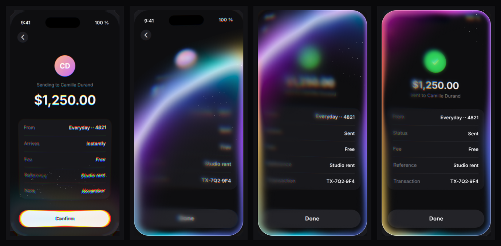

# distortion-wave

A distortion-wave transition for **any DOM element**. A button, a card, a tab panel, the whole page.

You give it an element and a function that changes the DOM. It captures the element before and after, then one WebGL2 pass carries the old state into the new one: the screen gets pulled toward the source, a lensed, blurred, colourful wave leaves from where you touched, and its colour lingers on the edges.



Inspired by Jakub Antalik's [Distortion Waves](https://libraries.dev/waves) for SwiftUI. This is an independent web implementation, not affiliated with libraries.dev.

- Zero dependencies, ~17 kB gzipped
- Same model as `document.startViewTransition()`
- Your update **always** runs: no WebGL, element off screen, reduced motion, capture error… you just get the change without the wave
- Keyboard focus is kept when your update replaces the focused control

## Install

Not on npm yet. From GitHub:

```sh
npm i github:LukyVj/distortion-wave
```

Or drop the IIFE build in a page:

```html
<script src="dist/distortion-wave.iife.min.js"></script>
<script>
  const { distortionWave } = window.DistortionWave;
</script>
```

## Usage

```js
import { distortionWave, warmupWave } from 'distortion-wave';

warmupWave(); // optional: compiles the shaders before the first click

confirmButton.addEventListener('click', (event) => {
  distortionWave(screen, () => {
    screen.dataset.state = 'sent';       // any DOM change: classes, innerHTML, a re-render…
  }, {
    source: confirmButton,               // where the wave starts
    focus: event,                        // the touch point: the wave leaves from there and leans that way
  });
});
```

The source can be inside or outside the target. When it is outside, the wave enters from that edge and travels toward the bulk of the target.

### A single button

```js
button.addEventListener('click', (event) => {
  distortionWave(button, () => {
    button.textContent = 'Subscribed';
  }, { focus: event });                  // no source: a ring from the touch point
});
```

### The whole page (theme switch)

```js
themeSwitch.addEventListener('click', (event) => {
  distortionWave(document.querySelector('#app'), () => {
    app.dataset.theme = app.dataset.theme === 'dark' ? 'light' : 'dark';
  }, { source: themeSwitch, focus: event });
});
```

Only the part visible in the viewport is captured and animated, so a long page costs the same as a screen.

### React

The DOM has to be updated when your callback returns, so wrap the state change in `flushSync` (same as with View Transitions):

```jsx
import { flushSync } from 'react-dom';
import { distortionWave } from 'distortion-wave';

function Checkout() {
  const screen = useRef(null);
  const [sent, setSent] = useState(false);
  return (
    <div ref={screen} className="screen">
      {sent ? <Receipt /> : <Review />}
      <button onClick={(e) => distortionWave(screen.current, () => flushSync(() => setSent(true)), { source: e.currentTarget, focus: e })}>
        Confirm
      </button>
    </div>
  );
}
```

### Shortcut

```js
import { waveOnClick } from 'distortion-wave';
waveOnClick(trigger, target, (event) => { /* update */ }, { palette: 'ocean' });
```

`waveOnClick` also pre-captures the target when the pointer enters the trigger or it gets focus, so the "before" capture costs nothing at click time.

## API

### `distortionWave(target, update?, options?) → WaveTransition`

| Option | Default | |
|---|---|---|
| `source` | touch point, else center | `Element`, `DOMRect`, `{ x, y }` |
| `focus` | `null` | the `PointerEvent`/`MouseEvent` (or `{ x, y }`). Keyboard clicks are ignored: the wave starts centered |
| `variant` | `'auto'` | `'vertical'`, `'horizontal'`, `'center'`. Auto: wide source → vertical, tall → horizontal, square or point → center |
| `palette` | `'aurora'` | `'aurora'`, `'ocean'`, `'mint'`, `'ember'`, or up to 8 hex colours (interpolated in OKLab) |
| `speed` | `1` | `0.3` for slow motion |
| `particles` | `true` | `false`, or a count |
| `reducedMotion` | follows `prefers-reduced-motion` | `true` gives a 220 ms crossfade |
| `preserveFocus` | `true` | move focus to the equivalent control if the update replaced the focused one |
| `timeout` | `3000` | max ms to wait for the "after" capture |
| `onLaunch`, `onCovered`, `onSettled`, `onEnd(metrics)` | | callbacks |

Any preset key (`amplitude`, `blur`, `rimWidth`, `lead`, `tail`, `swell`, `aberration`…) can be overridden too. Values are given for a 360×740 screen and scaled to the target, so a button gets a thinner rim and a shorter wave.

`WaveTransition` mirrors `ViewTransition`:

| | |
|---|---|
| `ready` | the overlay is up and animating |
| `updateCallbackDone` | your update finished (rejects if it threw) |
| `covered` | the old state is no longer visible |
| `finished` | the overlay is gone, the real DOM is back |
| `skip()` | jump to the end (the update still runs) |
| `metrics` | `{ captureBefore, captureAfter, upload, worstFrame }` in ms |

### Other exports

- `warmupWave()`: creates a WebGL context and compiles the shaders ahead of time.
- `prepareWave(target)`: pre-captures a target. Invalidated by any mutation.
- `snapshotElement(el, { dpr, clip })`: the DOM → canvas capture on its own.
- `PALETTES`, `PRESETS`, `scaleConfig`, `totalDuration`, `frameState`: the pure core, if you want to drive your own renderer.

## How it works

1. **Capture.** The element is cloned with every node's computed style inlined (pseudo-elements, form state, open shadow DOM, images and fonts turned into data URLs), serialized into an SVG `<foreignObject>`, and rasterized by the browser itself.
2. **Update.** The real element goes `opacity: 0` (it stays focusable and in the accessibility tree), a canvas sits on top, and your update runs during the anticipation.
3. **Capture again**, then build a blur pyramid once: sharp, near and far.
4. **One full-screen pass per frame.** A signed distance field gives the wave front. Around it the shader stacks a lens along the normal, chromatic aberration, a progressive blur blended from the pyramid, a colour band in OKLab, a rim on the element's own rounded corners, and dithering. Particles are drawn as points.
5. **Hand back.** As soon as the lens and blur are gone, the real element is shown again under the canvas and becomes interactive. The canvas only paints the lingering rim, then leaves.

All the timing lives in a pure function, `frameState(t, config, geometry)`. The GPU only paints, so any frame can be reproduced and tested.

## Performance

Capture times measured in headless Chrome at DPR 1, warm: a button ~2 ms, a card ~9 ms, a phone-sized screen ~13 ms, a whole app UI (100+ nodes) 50–75 ms. The anticipation phase hides them.

The rendering cost is one full-screen pass per frame (up to ~18 texture reads per pixel near the wave front, far fewer elsewhere). The DPR is capped at 2 and textures at ~4 Mpx. Up to 4 WebGL contexts are pooled and reused.

## Accessibility

- `prefers-reduced-motion` gives a short crossfade, no distortion.
- The trigger stays a real `<button>`. Keyboard activation works, and the wave starts centered.
- Focus is preserved when your update re-renders the focused control (same `id`, `data-focus-key` or `name`, then the same place in the tree). Text selection is kept. If your app moves focus itself, it is left alone.
- No flashing: the shimmer stays well under 3 flashes per second.

## Browser support & limits

- Needs WebGL2. Without it, the update runs with no animation.
- **Tested in Chromium only so far.** Safari and Firefox still need testing; Safari has a history of quirks with `foreignObject` images.
- Not captured: iframes (empty box), cross-origin images without CORS (transparent), inner scroll positions, `<use href="#…">` pointing outside the target.
- `body` and `html` cannot be targets. Wrap your app in an element.
- A target with `transform: scale()` may be slightly offset.

## Development

```sh
npm install
npm run build          # dist/ + demo/standalone.html
npm test               # unit tests for the pure core (node:test)
npx playwright install chromium
npm run test:browser   # end-to-end checks in Chromium (WebGL2 via SwiftShader)
npm run demo           # serves the repo; open /demo/
```

`demo/standalone.html` opens straight from disk, no server needed.

```
src/
  index.js      orchestration and public API
  core.js       pure: config, scaling, timeline, particles
  renderer.js   WebGL2 shaders, blur pyramid, context pool
  capture.js    DOM → bitmap through SVG foreignObject
  focus.js      keyboard focus preservation
```

## License

MIT © Lucas Bonomi
